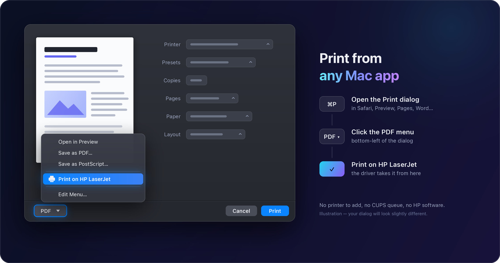
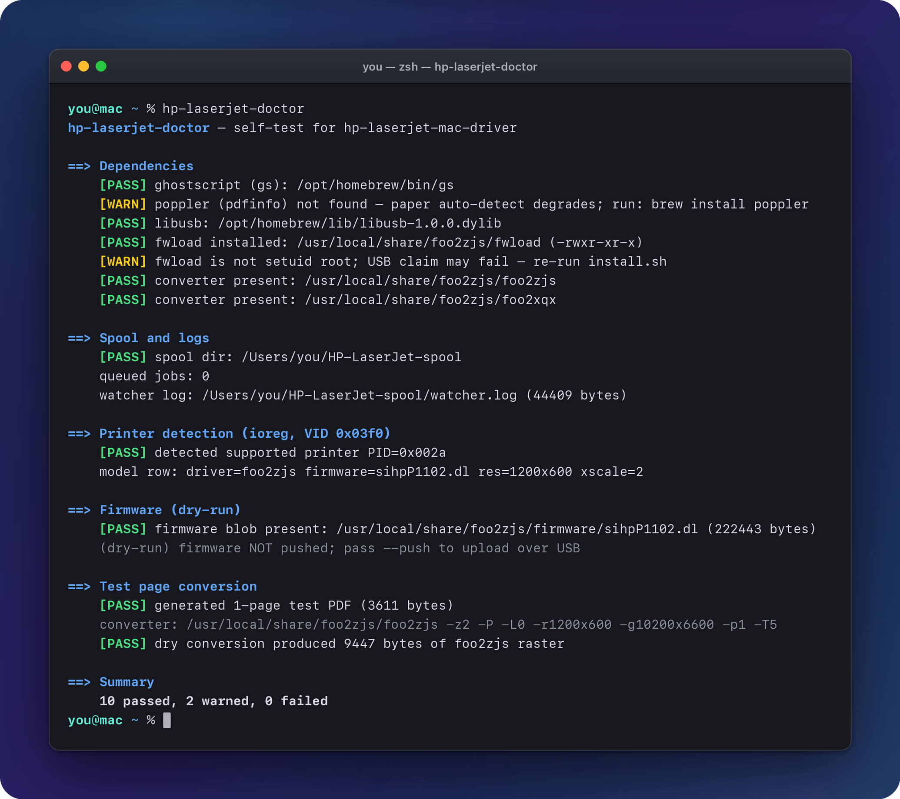
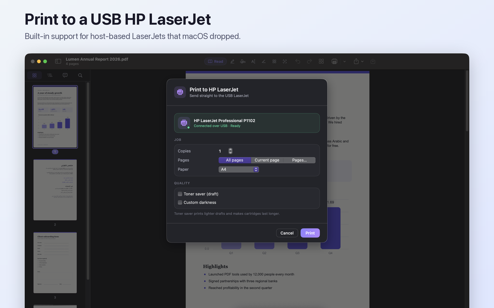
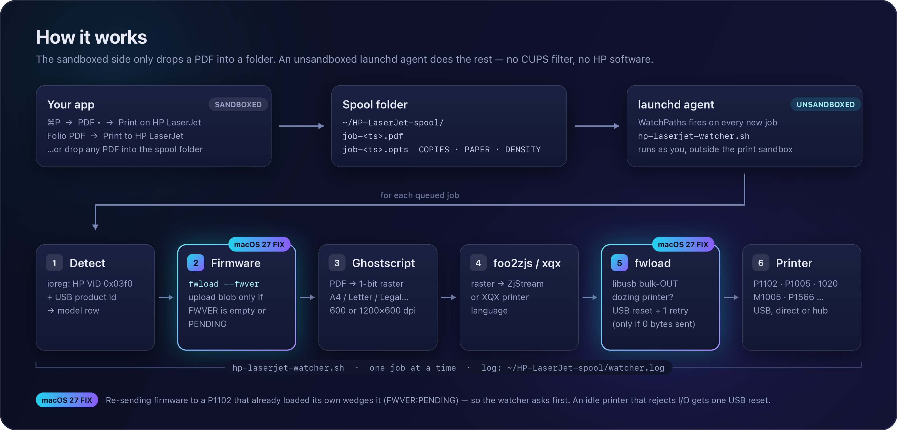

<h1 align="center">HP LaserJet P1102 Driver for macOS</h1>

<p align="center">
  <b>Print to an HP LaserJet P1102, P1005, 1020 or M1005 from a Mac on Apple Silicon or Intel (macOS 15–27).</b><br>
  No CUPS queue and no HP software. Press ⌘P and print.
</p>

<p align="center">
  <a href="LICENSE"></a>
  
  
  
  
  <a href="https://github.com/mhatem5351/hp-laserjet-macos-driver/actions/workflows/ci.yml"></a>
</p>

<p align="center">
  
</p>

> [!NOTE]
> **This is a fork of [hp-laserjet-mac-driver](https://gitlab.com/pauyedin/hp-laserjet-mac-driver)
> by Yedil Pauyedin (GitLab), with fixes for macOS 27.** The original driver and
> its design are Yedil Pauyedin's work, and the credit belongs to them. This fork
> adds a firmware-version check and a USB reset for printers that have gone idle
> (see [What this fork changes](#what-this-fork-changes)). The fixes are offered
> upstream. Licence: GPL-2.0, the same as upstream.

**Contents:** [Why](#why) · [Features](#features) · [Supported printers](#supported-printers) ·
[Quick install](#quick-install) · [Usage](#usage) · [Folio PDF](#works-great-with-folio-pdf) ·
[How it works](#how-it-works) · [Configuration](#configuration) ·
[Troubleshooting](#troubleshooting) · [Uninstall](#uninstall) · [Credits](#credits)

## Why

Many HP LaserJets still work fine after ten years or more: the **P1102 / P1102w**, **P1005 / P1006 / P1007 / P1008**,
**LaserJet 1018 / 1020** and the **M1005 MFP**. On a current Mac they often won't print:

- Apple no longer bundles an HP driver for these models, and HP's own software is long gone.
- The printers have **no AirPrint**, and they are **host-based (GDI)**. They have no PostScript
  or PCL interpreter, so the computer has to rasterise every page and, on most models, upload a
  firmware blob after each power-on.
- The macOS CUPS `usb` backend stops partway through jobs to these printers, and macOS
  **sandboxes CUPS filters**. A third-party filter in `/usr/local` gets `Operation not permitted`
  when it runs or touches USB.

This driver doesn't use CUPS at all. Ghostscript rasterises the page, `foo2zjs` / `foo2xqx`
convert it to the printer's own language, and a small libusb tool sends the bytes straight
to the printer. A macOS **PDF Service** adds **Print on HP LaserJet** to the normal Print dialog,
so you can print from any app.

## Features

- **Prints from any app.** Choose ⌘P → **PDF ▾** → **Print on HP LaserJet**. You don't add a printer or set up a queue.
- **Detects the model automatically.** The driver reads the USB product id and picks the matching
  protocol (ZjStream or XQX), firmware and raster geometry.
- **Native on Apple Silicon**, and works on Intel too. Built from source by `install.sh` against Homebrew's
  Ghostscript and libusb.
- **Handles firmware safely.** The printer is asked for its firmware version before every job, and the
  firmware is uploaded only when the printer needs it *(added in this fork)*.
- **Recovers a printer that has gone idle.** One USB reset and one retry, but only if no bytes were
  sent yet, so a page is never duplicated *(added in this fork)*.
- **Spool-folder intake.** Any app or script can print by dropping a PDF into `~/HP-LaserJet-spool/`.
  An optional `.opts` sidecar sets per-job copies, paper, density and toner-save.
- **`hp-laserjet-doctor`**: a read-only self-test with PASS/WARN/FAIL output.
- **Optional extras.** A menu-bar status app, a CUPS spooling backend that shows the printer in
  System Settings and lets you share it over AirPrint, notifications, and config for paper / density / EconoMode.
- **Stores no personal data.** The user, home folder and printer are detected at run time.

## Supported printers

The watcher picks the protocol from the attached printer's USB product id. If the id isn't in the
table, it also tries the product name.

| Model                       | USB PID  | Protocol / driver | Raster   | Status |
|-----------------------------|----------|-------------------|----------|--------|
| **P1102 / P1102w**          | `0x002a` | ZjStream `foo2zjs`| 1200×600 | ✅ verified (incl. **macOS 27**) |
| **M1005 MFP**               | `0x3b17`¹ | XQX `foo2xqx`    | 1200×600 | ✅ verified (macOS 26.5) |
| LaserJet 1000               | `0x0517` | ZjStream `foo2zjs`| 600×600  | ⚠️ untested |
| LaserJet 1005               | `0x1317` | ZjStream `foo2zjs`| 600×600  | ⚠️ untested |
| LaserJet 1018               | `0x4117` | ZjStream `foo2zjs`| 600×600  | ⚠️ untested |
| LaserJet 1020               | `0x2b17` | ZjStream `foo2zjs`| 600×600  | ⚠️ untested |
| P1566 / P1606               | `0x092a` | ZjStream `foo2zjs`| 1200×600 | ⚠️ untested |
| P1005                       | `0x3d17` | XQX `foo2xqx`     | 1200×600 | ⚠️ untested |
| P1006                       | `0x3e17` | XQX `foo2xqx`     | 1200×600 | ⚠️ untested |
| P1007 / P1008               | `0x4817` / `0x4917` | XQX `foo2xqx` | 1200×600 | ⚠️ untested |
| P1505 / P1505n              | `0x3f17` / `0x4017` | XQX `foo2xqx` | 1200×600 | ⚠️ untested |

> **Only two models have been tested on real hardware: the P1102 and the M1005 MFP.**
> The P1102 was verified on **macOS 27** (Apple Silicon, through a USB hub) with this fork's fixes.
> The M1005 was verified upstream on macOS Tahoe 26.5.2 (Apple M5, through a USB 2.0 hub).
> Every other row uses the same code path but nobody has tested it on hardware yet. Reports are very
> welcome, whether the printer works or not (see [`TESTED.md`](TESTED.md) and
> [`CONTRIBUTING.md`](CONTRIBUTING.md)). macOS 15 uses the same mechanism and should work, but it
> hasn't been verified either.
>
> ¹ The M1005 MFP's USB product id isn't in the driver's own device table. `0x3b17` (confirmed on
> the tested unit) is used, and the watcher also matches the M1005 by product name, so detection
> works either way. Its print engine is P1005-class and it uses the P1005 XQX firmware
> (`sihpP1005.dl`). The HPLIP plugin has no separate M1005 blob, and none is needed.

## Quick install

```bash
git clone https://github.com/mhatem5351/hp-laserjet-macos-driver.git
cd hp-laserjet-macos-driver
./install.sh
```

Requirements (the installer checks for them and installs the Homebrew packages):

- [Homebrew](https://brew.sh)
- Xcode Command Line Tools (`xcode-select --install`)
- `ghostscript`, `libusb`, `poppler` (installed automatically)

`install.sh` builds `foo2zjs` / `foo2xqx` from the bundled source and compiles `fwload` against libusb.
It sets up the firmware blobs and installs everything into `/usr/local/share/foo2zjs`. It asks for your
password once, because `fwload` is installed **setuid root** so that the per-user launchd agent can
claim the printer's USB interface. Finally it loads the launchd watcher and the Print-dialog PDF
Service. Plug the printer in with USB, either directly or through a hub, and you're done.

> Homebrew users: the tap described in [`HOMEBREW.md`](HOMEBREW.md) installs **upstream's** release,
> which doesn't have the macOS 27 fixes. Use the commands above to install this fork.

## Usage

### From the Print dialog (any app)

**⌘P → PDF ▾ (bottom-left) → Print on HP LaserJet**

<p align="center">
  
</p>

The PDF Service runs inside the macOS print sandbox, so all it does is copy the PDF into the spool
folder. The unsandboxed launchd watcher does the actual printing. The first page after the printer
powers on can take about 20 seconds while firmware loads, on models that need it.

### Two-sided printing on a one-sided printer

**⌘P → PDF ▾ → Print on HP LaserJet (two-sided)**, or **Sides: Both sides** in Folio PDF.

The front sides print first. A dialog then asks you to take the stack from the output tray, keep its
order, and put it back in the input tray **printed side down, top of the pages first**. The back sides
then print **in reverse order**, so each lands behind its own front. Odd page counts get a blank back for
the last sheet, and page ranges work too (pages 3–7 → fronts 3 5 7, backs blank 6 4). Details:
[docs/CONFIG.md](docs/CONFIG.md#two-sided-printing-by-hand-duplexmanual).

### By dropping a PDF into the spool folder

Anything that can write a file can print. Copy the file under a temporary name first, then rename it
to `job-*.pdf`, so the watcher never picks up a half-written file:

```bash
ts=$(date +%s)
cp document.pdf ~/HP-LaserJet-spool/.incoming-$ts
# optional per-job options: write the sidecar *before* the PDF appears
printf 'COPIES=2\nPAPER=a4\nDENSITY=3\nECONOMODE=on\n' > ~/HP-LaserJet-spool/job-$ts.opts
mv ~/HP-LaserJet-spool/.incoming-$ts ~/HP-LaserJet-spool/job-$ts.pdf
```

See [`docs/CONFIG.md`](docs/CONFIG.md) for all sidecar and config keys.

### Check your setup with `hp-laserjet-doctor`

```bash
hp-laserjet-doctor          # read-only: never touches the printer over USB
```

<p align="center">
  
</p>

<sub>Real output from a P1102 test machine (the username is replaced with <code>you</code>). The two
warnings come from local changes on that machine (no <code>poppler</code>, and <code>fwload</code>
installed without setuid). A standard <code>./install.sh</code> doesn't have either.</sub>

## Works great with Folio PDF

[**Folio PDF**](https://github.com/mhatem5351/folio-pdf-mac) is a free, open-source PDF editor for macOS
by the author of this fork. It has a built-in **Print to HP LaserJet** sheet that sends jobs straight into
this driver's spool folder. It writes a `job-<ts>.opts` sidecar with **copies, paper size, density,
EconoMode and sides (one or both)**, so you can set per-job options that the sandboxed macOS Print dialog
can't pass along. Its page-range picker works together with two-sided printing.

<p align="center">
  
</p>

The integration is just the spool folder plus the documented sidecar format, so any other app can do
the same thing (see [Usage](#by-dropping-a-pdf-into-the-spool-folder)).

## How it works

<p align="center">
  
</p>

```
Cmd+P ▸ PDF ▾ ▸ "Print on HP LaserJet"
        │  (Automator Print Plugin, runs in the print sandbox)
        ▼
  copies the PDF into ~/HP-LaserJet-spool/
        │
        ▼
  launchd WatchPaths agent  ──►  hp-laserjet-watcher.sh   (runs unsandboxed)
        │
        ├─ detect  : read attached printer's USB product id/name → model row
        ├─ fwver   : ask the printer for its firmware version (fwload --fwver)
        ├─ fwload  : upload the firmware blob ONLY if it reports none / PENDING
        ├─ gs      : PDF → monochrome raster (auto A4 / Letter, model geometry)
        ├─ foo2zjs : raster → ZjStream  (-z2 -P -L0)   [ZjStream models]
        │  foo2xqx : raster → XQX       (-P -L0)       [XQX models]
        └─ fwload  : stream the result to the printer's bulk-OUT endpoint
                     (one USB reset + retry if a dozing printer rejects I/O
                      before any byte was sent)
```

The printer is matched by USB **VID 0x03f0** plus one of the family product ids
(see the table above), so no per-machine serial number is stored anywhere. If
no supported printer is detected, the watcher leaves the queued jobs in the
spool and defers — it never guesses a model — so a job queued while the printer
is off or re-enumerating is not driven with the wrong protocol/firmware.

### Multiple printers

If **several** supported HP LaserJets are attached at once, the watcher detects
them all and needs to choose a target (the sandboxed Print dialog can't tag a
job with a destination). Set `PRINTER` in `~/.config/hp-laserjet/config` to a
USB product id (`PRINTER=0x3d17`) or a product-name substring (`PRINTER=p1005`)
to pin all jobs to one printer; a `PRINTER=` line in a per-job
`job-<ts>.opts` sidecar routes a single job. With `PRINTER` unset, the watcher
falls back to a deterministic primary (the lowest product id present) and logs
which printer it chose and which it ignored. With only one printer attached this
is all inert — behaviour is unchanged. See
[`docs/CONFIG.md`](docs/CONFIG.md#selecting-a-printer-when-several-are-connected).

## What this fork changes

Upstream v0.2.0 was verified on macOS 26. Testing a P1102 on **macOS 27** through a USB hub showed two
ways printing could fail. Both come from how the printer behaves, so they may not be specific to macOS 27.
Both are fixed here, and the details are in [`CHANGELOG.md`](CHANGELOG.md).

| Problem | Cause | Fix |
|---|---|---|
| After the first job, the printer stops responding (`FWVER:PENDING`, USB error `0xe00002ed`) until you power-cycle it | The watcher re-sent the firmware before **every** job. A P1102 that already loaded its firmware from its own flash doesn't ignore a second copy. It resets into a stuck state. | New `fwload --fwver` reads `FWVER` from the printer's IEEE-1284 device ID. Firmware is uploaded **only** when the printer reports none or `PENDING`. If the query fails, the upload is skipped instead of sent blind. |
| The first job after the printer has been idle fails with `LIBUSB_ERROR_IO` / `PIPE` / `TIMEOUT` | A dozing printer rejects the first USB request | `fwload` does one `libusb_reset_device` (and re-opens the device if it re-enumerates), then retries. It only does this if **zero** bytes were sent, so a partly sent job is never sent twice. |
| *(hardening)* | `fwload` is setuid root | It now opens the firmware/raster file with your own user id (`seteuid(getuid())`) and uses root only for USB access. |

Tested with a P1102 (`FWVER:20120814` unit) on macOS 27 and Apple Silicon through a USB hub,
printing from the macOS Print dialog and from Folio PDF's spool-folder sheet.

## Configuration

The driver works with no configuration. Optionally, an
`~/.config/hp-laserjet/config` file (`KEY=value`) can set defaults such as
`PAPER`, print-quality controls `DENSITY` (`1`–`5`, the converter `-T` darkness
flag) and `ECONOMODE` (`on`/`off`, toner-save `-t`), copies/layout defaults
`DEFAULT_COPIES` / `DEFAULT_DUPLEX` / `DEFAULT_NUP`, and `PRINTER` (which printer
to use when several are attached), paper geometry `PAPER` / `SCALE` / `MARGIN`;
a per-job `job-<ts>.opts` sidecar can carry per-job `COPIES` / `DUPLEX` / `NUP` /
`DENSITY` / `ECONOMODE` / `PRINTER` / `PAPER` / `SCALE` / `MARGIN` overrides. The macOS print dialog's copies/two-sided/layout controls are **not**
read (the PDF Service is sandboxed) — use the config file or sidecar instead.
Note most supported models are simplex-only (duplex is passed through and
logged) and the converters have no N-up (`NUP>1` is ignored). See
[`docs/CONFIG.md`](docs/CONFIG.md) for the full key reference. With neither
config nor sidecar present, behaviour is unchanged.

## Notifications

The watcher posts a macOS notification when a job finishes — "Printed on …" on
success, a short failure reason otherwise (including when no supported printer is
on the bus and a job is left queued). Set `NOTIFY` in the config file to
`all` (default), `errors` (failures only), or `none` to silence them. Notifications
are best-effort UX and never change whether or how a job prints.

## Troubleshooting

Start with **`hp-laserjet-doctor`**, then look at the end of `~/HP-LaserJet-spool/watcher.log`.

### The printer stops responding: `FWVER:PENDING` or USB error `0xe00002ed`

This means the printer has wedged after receiving firmware it didn't need. Some units, such as many
P1102s, load firmware from their own flash at power-on. Sending them the blob again leaves them stuck in
`PENDING`, and all later USB transfers fail. This fork's watcher asks first and skips the upload when
the printer already reports a version, so it shouldn't happen any more. If a printer is already stuck:

1. **Power-cycle the printer.** Switch it off, wait about 10 seconds, and switch it on. A USB reset
   doesn't clear this state, but a power cycle does.
2. Check it: `/usr/local/share/foo2zjs/fwload --fwver 0x03f0 0x002a` (use your model's PID) should
   print a date-like version such as `20120814`. It prints `PENDING` if the printer still wants
   firmware, and nothing if the printer doesn't report a version.
3. Print again. The log should show `firmware already loaded (FWVER:…), skipping upload`.

### The first job after a long idle fails (`LIBUSB_ERROR_IO`, `PIPE`, `TIMEOUT`)

The printer has dozed off and rejects the first USB request. `fwload` now logs
`usb: resetting printer after I/O error`, resets the port and retries once. It does this only if no
bytes reached the printer, so you never get garbage or duplicate pages. If the job still fails:

- Unplug and re-plug the USB cable, or try a different port or hub. Unpowered hubs sometimes can't
  wake the printer.
- Power-cycle the printer. The failed job is not lost: it waits in `~/HP-LaserJet-spool/failed/`, and
  once the printer is back (replugged or switched on) a dialog asks whether to **Print** it again,
  keep it for **Later**, or **Discard** it.

### Every job fails with `0xe00002ed (transaction error)`

If `fwload` accepts a 48-byte status query (`fwload --status 0x03f0 <pid>`) but every real job fails
on its first write, check the kernel log:
`/usr/bin/log show --last 10m --predicate 'senderImagePath CONTAINS[c] "USB"' | grep transaction`.
`status 0xe00002ed (transaction error)` on the printer's endpoints is a USB link fault below the
driver. Power-cycle the printer, and plug it straight into the Mac rather than through a hub or dock.

### Other quick checks

- **Nothing happens at all:** run `launchctl list | grep hp-laserjet` to confirm the watcher agent is
  loaded, and check that `~/HP-LaserJet-spool/` exists.
- **Job stays in the spool:** no supported printer was detected. The watcher never guesses a model.
  Check the cable, then run `hp-laserjet-doctor`.
- **"Print on HP LaserJet" is missing from the PDF menu:** re-run `./install.sh`. The workflow
  lives in `~/Library/PDF Services/`.

### Self-test (`hp-laserjet-doctor`) in detail

`hp-laserjet-doctor` runs a quick end-to-end diagnostic and prints a PASS/FAIL
summary per check. `install.sh` puts it on your `PATH`:

```bash
hp-laserjet-doctor
```

(or run it in place: `/usr/local/share/foo2zjs/hp-laserjet-doctor.sh`).

With no flags it is **entirely read-only** — it never touches the printer over
USB. It checks:

- **Dependencies** — `ghostscript` (gs), `libusb`, `poppler` (pdfinfo), and the
  installed `fwload` (including its setuid-root bit) and the `foo2zjs`/`foo2xqx`
  converters.
- **Printer detection** — reads the attached HP LaserJet over `ioreg` (VID
  `0x03f0`), exactly as the watcher does, and prints the matched model row
  (driver / firmware / RES / XSCALE). If **no** supported printer is on the bus
  it reports that and exits non-zero with guidance — it never guesses a model.
- **Firmware (dry-run)** — verifies the firmware blob for the detected model is
  installed and reports its path and size.
- **Test-page conversion** — generates a one-page test PDF and runs a **dry**
  conversion (`gs` → `foo2zjs`|`foo2xqx`), reporting the raster byte count. No
  bytes are written to USB.

Flags for the on-hardware tests:

| Flag       | Effect                                                                 |
|------------|------------------------------------------------------------------------|
| `--push`   | also upload the detected model's firmware blob over USB (`fwload`).    |
| `--print`  | run the full pipeline and print the test page on the detected printer (implies `--push`). |
| `-h`, `--help` | show usage.                                                        |

The exit status is non-zero if any check fails (including no supported printer),
so it is safe to script.

### Printer status (PJL)

`fwload` can query the printer's status without printing a page:

```bash
/usr/local/share/foo2zjs/fwload --status 0x03f0 <PID>
```

`<PID>` is the printer's USB product id (e.g. `0x002a` for the P1102; see the
`model_row` table in `hp-laserjet-watcher.sh`). This sends a PJL status query
(`@PJL INFO STATUS` / `@PJL INFO PAGECOUNT`) to the printer and prints its reply:

- `status-line: …` — any human-readable text line the printer returned.
- `status-kv: …` — lines carrying a recognized PJL token (`CODE=`, `DISPLAY=`,
  `ONLINE`, `TONER`, `PAGECOUNT`, `PAGES`), i.e. the parseable status values.
- A byte-count summary if the reply is binary or empty.

The same parsing runs automatically after every job, so these `status-line:` /
`status-kv:` lines also appear in `~/HP-LaserJet-spool/watcher.log` — a status
poller or menu-bar can read device state straight from the log or by calling
`fwload --status`. It is best-effort and never affects whether a job succeeds.

### Notes & limitations

- **First page after power-on** is slow (~20 s) while firmware uploads. Normal.
- USB detection uses `ioreg` (not `system_profiler`, which returns nothing on
  macOS Tahoe). `fwload` targets the USB Printer-class interface, so MFPs like
  the M1005 print from the right interface, not the scanner one.
- **Paper size** auto-detects **A4** vs **US Letter** from the PDF by default.
  Set `PAPER` (config or per-job sidecar) to force a size: `letter`, `a4`,
  `legal`, `a5`, `executive`, `com10` (#10 envelope) or `dl` (DL envelope) —
  each maps to the printer's paper code and the correct raster grid. Anything
  unrecognised still falls back to Letter. `SCALE` (percent) and `MARGIN`
  (points) further adjust the page during rasterisation. See
  [`docs/CONFIG.md`](docs/CONFIG.md).
  **`letter` and `a4` are hardware-verified; `legal`, `a5`, `executive`,
  `com10` and `dl` are not yet tested on real hardware** — their paper codes and
  grids match the converters' tables but are unproven, so treat them as
  experimental and report results.
- **Hardware-tested: P1102 and M1005 MFP.** Other models use the same mechanism
  (ZjStream via `foo2zjs`, or XQX via `foo2xqx`) and *should* work; the
  `model_row` table in `hp-laserjet-watcher.sh` (USB PID → driver + firmware +
  resolution) is where to fix or add a model if yours misbehaves.
- **Faint stripes / ghosting** are the toner cartridge (HP **CE285A / 85A**),
  not this software. Shake the cartridge; replace if it persists.
- Monochrome only (they're mono lasers).

## Optional extras

### Menu-bar app

A small native macOS menu-bar (`NSStatusItem`) utility lives in
[`menubar/`](menubar/). It shows a printer icon with printer online/offline
status, the queued job count, and one-click actions to retrigger the watcher,
open the spool folder, view the log, and clear the spool. It is a standalone
single-file Swift executable (built with `swiftc`, no Xcode project) and never
touches USB — all printing stays in the watcher. See
[`menubar/README.md`](menubar/README.md) for build, run and launch-at-login
instructions. It shows live per-job progress, a toner / page-count badge (read
from the PJL status lines in the log), and queue actions (cancel a job,
reprint-last), in addition to online/offline status and the spool actions.

### System Settings & AirPrint (optional CUPS backend)

An optional CUPS *spooling* backend in [`cups-backend/`](cups-backend/) makes
the printer appear in **System Settings › Printers** and lets you
**AirPrint-share** it to iPhones and iPads on your network. It is completely
independent of the core driver — if you never install it, nothing changes.

Crucially it **never touches USB and never execs the driver**: it only writes
the incoming job as `job-<ts>.pdf` into `~/HP-LaserJet-spool/` — the same intake
the PDF Service uses — so the real work still happens only in the unsandboxed
watcher. That is why it does *not* reintroduce the "CUPS can't drive this
printer" problem. Install it separately:

```bash
sudo cups-backend/install-cups-backend.sh
```

See [`cups-backend/README.md`](cups-backend/README.md) for the queue name,
AirPrint sharing steps, and uninstall.

### Scanner (M1005 MFP): experimental scaffolding

[`scanner/`](scanner/) holds **scaffolding only — there is no working scan yet.**
It contains a libusb probe skeleton (`hp-scan.c`) that opens the M1005's
vendor-specific scan interface and dumps its endpoint descriptors, plus protocol
notes. The actual scan command/data handshake is not implemented: it needs a USB
capture (or a port of SANE's `hpaio`). `scanner/PROTOCOL.md` is the template a
hardware owner can use to record that capture. It is not built or installed by
`install.sh`. See [`scanner/README.md`](scanner/README.md).

## Compatibility & test reports

Only the P1102 and the M1005 MFP have been tested on hardware. Every other model uses the same code path
but hasn't been tested. [`TESTED.md`](TESTED.md) tracks the status of each model
(✅ verified / ⚠️ untested / ❌ broken), with the tester and macOS version.

**If you have one of the untested models, a report is the most useful contribution you can make**, whether
it works or not. Open a [*Test report* issue](https://github.com/mhatem5351/hp-laserjet-macos-driver/issues/new?template=test-report.md)
with your model, USB PID, macOS version and the end of your `watcher.log` with personal details removed.
To add or fix a `model_row()` entry, open a pull request. The PR template has the checklist.
See [`CONTRIBUTING.md`](CONTRIBUTING.md).

## Uninstall

```bash
./uninstall.sh
```

This unloads and removes the launchd watcher, the PDF Service, `/usr/local/share/foo2zjs` and the
`hp-laserjet-doctor` symlink. It leaves `~/HP-LaserJet-spool` and the Homebrew packages
(`ghostscript`, `libusb`, `poppler`) in place.

## Credits

- **[Yedil Pauyedin](https://gitlab.com/pauyedin)**, author of the original
  [hp-laserjet-mac-driver](https://gitlab.com/pauyedin/hp-laserjet-mac-driver). The architecture,
  the watcher, the PDF Service, `fwload`, multi-model support, the doctor, the menu-bar app and the
  CUPS backend are all their work. This fork only adds the macOS 27 fixes and the documentation for them.
- **[foo2zjs](http://foo2zjs.rkkda.com)** by **Rick Richardson**: the ZjStream (`foo2zjs`) and XQX
  (`foo2xqx`) drivers that make these printers usable outside Windows (GPL).
- **[Ghostscript](https://www.ghostscript.com)** (Artifex) rasterises PDF pages.
- **[libusb](https://libusb.info)** provides portable user-space USB access.
- The firmware blobs are **HP's**. They come from the HPLIP plugin (one per model; the M1005 MFP uses
  the P1005 blob).

## License

The installer, watcher, PDF Service and `fwload.c` in this repo are licensed under **GPL-2.0** (see
[`LICENSE`](LICENSE)), matching upstream and the bundled `foo2zjs`.
Firmware and `foo2zjs` keep their own licences:

- `vendor/foo2zjs-src.tar.gz` is an unmodified snapshot of Rick Richardson's foo2zjs sources (GPL).
- `vendor/sihpP1102.dl` is **HP's proprietary P1102 firmware**, as extracted from HP's HPLIP plugin.
  Upstream includes it so the P1102 can be installed offline, and this fork keeps it on the same terms. It isn't covered by the GPL, and all
  rights stay with HP. Firmware for the other models isn't included; `install.sh` extracts it from
  HP's HPLIP plugin (downloaded from OpenPrinting) at install time.

HP and LaserJet are trademarks of HP Inc. This project isn't affiliated with or endorsed by HP.
